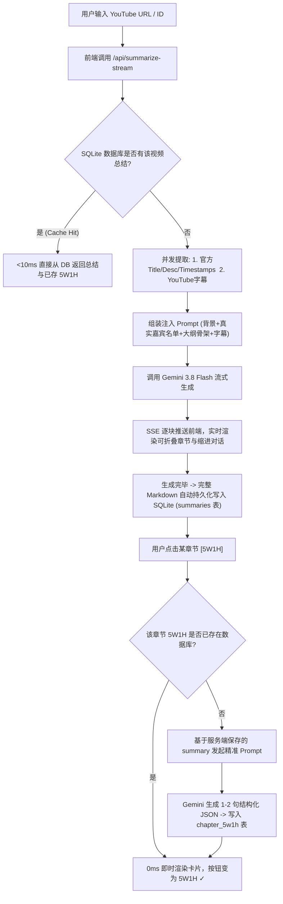

# YouTube 对话深度总结与 5W1H 精读系统 (YouTube Transcript & 5W1H App)

本项目是一个极简、高信息密度的 YouTube 访谈/播客智能分析与精读系统。支持从 YouTube 视频链接自动提取官方背景、真实演职员名单、时间戳大纲与全文字幕，使用 Google Gemini 3.8 Flash 模型流式生成结构化对话总结，并支持基于章节的按需 5W1H 归纳与全量持久化。

后端以 Hono 编写单一套路由，存储层是异步接口 + 两份实现：本地 `better-sqlite3`（`data/app.db`）与 Cloudflare D1。因此同一份代码既可以用 `npm run dev` 在本机跑，也可以直接部署到 Cloudflare Workers + D1，无需维护两套 API。

---

## 目录
- [1. 核心特性](#1-核心特性)
- [2. 系统架构与技术栈](#2-系统架构与技术栈)
- [3. 数据库设计 (Cloudflare D1 兼容)](#3-数据库设计-cloudflare-d1-兼容)
- [4. 核心工作流与工程细节](#4-核心工作流与工程细节)
- [5. 关键 Bug 复盘与排错经验 (Gotchas)](#5-关键-bug-复盘与排错经验-gotchas)
- [6. API 接口文档](#6-api-接口文档)
- [7. 本地开发与运行指南](#7-本地开发与运行指南)

---

## 1. 核心特性

1. **极简交互设计（Zero Bloat UI）**：
   - 彻底摒弃繁杂的元数据框、冗余标签页（Tab）与杂乱按钮，输入链接后直接以 Server-Sent Events (SSE) 极速流式输出排版工整的文章。
2. **章节可折叠与排版结构化**：
   - 全文按二级标题（`##`）划分为宏观大主题，每个章节均支持一键折叠/展开。
   - 自动过滤 Markdown 前置冗余，彻底杜绝空白章节或“章节1”前导错误。
3. **发言人对话缩进与分层视觉**：
   - 智能识别提问人（主持人/记者）与回答人（受访嘉宾），赋予不同色彩高亮。
   - 对话发言内容缩进排版（`speech-body`），说话人提及的分点列表（Bullet points）二次嵌套缩进，阅读层次极具节奏感。
4. **YouTube 官方背景与演职员名单注入**：
   - 在抓取字幕时，服务端自动爬取 YouTube 视频官方 Description、Title、Channel 与 Timestamps（官方时间戳）。
   - 将官方演职员名单（如 Marc Andreessen、Ben Horowitz、Chris Dixon、Erik Torenberg 等）注入模型 Prompt，**彻底解决大模型瞎猜、误判人数或使用通用虚拟假名（如 "Jen:"、"John:"）的问题**。
   - 将官方时间戳作为章节划分的骨架基准，确保总结与视频原作者的官方剪辑大纲 100% 契合。
5. **章节 5W1H 归纳与刷新自动恢复**：
   - 每个章节标题旁均提供独立的 `[5W1H]` 按钮。
   - **严格基于服务端已保存的总结进行归纳**（而非重新读取 20,000 字长字幕），每项输出 1-2 句高密度本质提炼（Who / What / When / Where / Why / How）。
   - **全量持久化**：用户生成的 5W1H 自动存入数据库；刷新页面或通过 RESTful 路径 `/summary/:videoId` 访问时，自动拉取已生成的 5W1H 并高亮标记 `5W1H ✓`，无缝恢复现场。

---

## 2. 系统架构与技术栈

- **Runtime**: Node.js (v20+) 与 Cloudflare Workers 双运行时 / TypeScript
- **Web 框架**: Hono（同一份路由实现跑在本地 Node 与 Worker 上）
- **AI 模型**: Google Gemini API (`gemini-3.8-flash` via `@google/genai/web`)
- **网络代理**: `undici` + `EnvHttpProxyAgent`（仅本地 Node 运行时；稳定支持 Clash / Karing 等 HTTP/HTTPS 代理通道）
- **存储**: 统一的异步 `VideoRepository` 接口 + 两份实现 —— 本地 `better-sqlite3`（WAL 模式），线上 Cloudflare D1
- **前端架构**: 纯原生轻量 SPA (HTML5 + CSS Variables + Vanilla JS)，无打包负担，秒级加载；内置 Marked.js 进行安全行内 Markdown 解析。

```
youtube-transcript-app/
├── data/
│   └── app.db               # 本地 SQLite 数据库文件 (Cloudflare D1 兼容)
├── public/
│   ├── index.html           # SPA 主入口 (含 <base href="/" />)，同时作为 Worker 静态资源
│   ├── style.css            # 现代化暗色主题样式 (折叠、缩进、5W1H网格卡片)
│   ├── app.js               # 前端状态、SSE流式接收、5W1H交互与渲染逻辑
│   └── vendor/
│       └── marked.min.js    # 客户端轻量 Markdown 解析器
├── src/
│   ├── app.ts               # Hono 应用工厂：全部 API 路由、SSE 流式逻辑、Prompt 组装
│   ├── node-main.ts         # 本地入口：dotenv + 代理 + better-sqlite3 + 静态文件 (默认 :3030)
│   ├── worker-main.ts       # Worker 入口：D1 绑定 + Assets 静态资源
│   ├── repositories/
│   │   ├── types.ts         # VideoRepository 异步接口
│   │   ├── sqlite.ts        # better-sqlite3 实现 (本地)
│   │   ├── d1.ts            # D1 实现 (Workers)
│   │   └── heading.ts       # 章节标题归一化与模糊匹配（两份实现共用）
│   ├── prompts.ts           # 总结与 5W1H Prompt
│   └── utils/               # youtube / retry / errors / logger / section
├── migrations/
│   └── 0001_init.sql        # D1 表结构（与 SQLite 完全一致）
├── scripts/
│   └── export-sqlite-to-d1.mjs  # 把 data/app.db 导出为 D1 可导入的 SQL（超长文本自动分块）
├── legacy/                  # 迁移前的 Express + 同步 db 实现，仅作留档，不再参与构建
├── wrangler.toml            # Worker / D1 / Assets 配置
├── .env                     # 本地环境变量 (PORT, GEMINI_API_KEY, HTTPS_PROXY)
└── .dev.vars                # wrangler dev 本地变量 (GEMINI_API_KEY)，已被 gitignore
```

---

## 3. 数据库设计 (Cloudflare D1 兼容)

所有表与字段采用标准 SQLite DDL，确保将来上线 Cloudflare Workers 时可通过 `wrangler d1 execute` 零改动迁移。

```sql
-- 1. 视频主表
CREATE TABLE IF NOT EXISTS videos (
  id TEXT PRIMARY KEY,
  youtube_id TEXT UNIQUE NOT NULL,
  url TEXT NOT NULL,
  title TEXT,
  description TEXT,
  created_at DATETIME DEFAULT CURRENT_TIMESTAMP
);

-- 2. 原始字幕缓存表
CREATE TABLE IF NOT EXISTS transcripts (
  video_id TEXT PRIMARY KEY,
  plain_text TEXT NOT NULL,
  created_at DATETIME DEFAULT CURRENT_TIMESTAMP,
  FOREIGN KEY (video_id) REFERENCES videos(id)
);

-- 3. 完整 Markdown 对话总结表
CREATE TABLE IF NOT EXISTS summaries (
  video_id TEXT PRIMARY KEY,
  summary_markdown TEXT NOT NULL,
  created_at DATETIME DEFAULT CURRENT_TIMESTAMP,
  FOREIGN KEY (video_id) REFERENCES videos(id)
);

-- 4. 章节 5W1H 归纳表
CREATE TABLE IF NOT EXISTS chapter_5w1h (
  id TEXT PRIMARY KEY,
  video_id TEXT NOT NULL,
  chapter_heading TEXT NOT NULL,
  who TEXT NOT NULL,
  what TEXT NOT NULL,
  when_time TEXT NOT NULL,
  where_place TEXT NOT NULL,
  why TEXT NOT NULL,
  how TEXT NOT NULL,
  created_at DATETIME DEFAULT CURRENT_TIMESTAMP,
  UNIQUE(video_id, chapter_heading),
  FOREIGN KEY (video_id) REFERENCES videos(id)
);
```

---

## 4. 核心工作流与工程细节



### 4.1 章节匹配模糊归一化 (`normalizeHeading`)
为解决前端界面中章节可能带有的数字前缀（如 `一、`、`1.`）、中英文冒号或空格差异，服务端与前端均引入了统一的归一化函数：
```javascript
function normalizeHeading(h) {
  if (!h) return '';
  return h
    .replace(/^[#\s一二三四五六七八九十\d.、-]+/, '')
    .replace(/[：:\s\-_—·]/g, '')
    .trim()
    .toLowerCase();
}
```
使 `## 一、 智能经济：收入爆发与成本塌陷` 能够 100% 命中数据库中存储的 `智能经济：收入爆发与成本塌陷`。

---

## 5. 关键 Bug 复盘与排错经验 (Gotchas)

后来的 Agent 会话请务必注意以下工程要点：

1. **Undici 代理的 10 秒超时陷阱 (`ConnectTimeoutError`)**：
   - **现象**：当传输数万字长文本字幕时，Gemini API 偶发抛出 `UND_ERR_CONNECT_TIMEOUT: Connect Timeout Error (timeout: 10000ms)`。
   - **根因**：Node 20+ 的 `undici` 内部默认连接超时仅为 10,000ms（10秒）。跨本地代理隧道发送大包时，TLS 握手如果超过 10 秒即被强行掐断。
   - **解法**：在 `server.ts` 初始化 `EnvHttpProxyAgent` 时，显式配置充足的超时参数：
     ```typescript
     setGlobalDispatcher(
       new EnvHttpProxyAgent({
         connect: { timeout: 60_000 },
         headersTimeout: 180_000,
         bodyTimeout: 180_000
       })
     );
     ```

2. **Gemini 废弃模型问题**：
   - Google 已废弃 `gemini-2.0-flash`，API 会直接返回 `404 (models/gemini-2.0-flash is no longer available)`。
   - **解法**：必须统一使用 **`gemini-3.8-flash`**。

3. **SPA 刷新白屏 / 相对路径资源 404**：
   - **现象**：直接刷新 `/summary/:videoId` 路由时页面白屏或样式丢失。
   - **根因**：静态资源若使用相对路径 `href="style.css"`，浏览器在 `/summary/xxx` 下会请求 `/summary/style.css` 造成 404；且 Express 的通配路由不能拦截静态文件。
   - **解法**：
     - 在 `public/index.html` 的 `<head>` 中添加 `<base href="/" />`，静态引用全部使用根绝对路径（如 `/style.css`、`/app.js`）。
     - Express 路由限定严格正则：`app.get(['/summary/:videoId([a-zA-Z0-9_-]{11})', ...])`。

4. **流式中断时前端悬挂在“正在实时流式生成中...”**：
   - **解法**：在 `app.js` 的 `startGeneration` catch 块中，检测 `fullAccumulatedMarkdown` 是否为空。若为空则立刻隐藏 `outputContainer`，并在顶部错误栏展示具体错误原因，杜绝空卡片假死。

---

## 6. API 接口文档

### 1. `POST /api/summarize-stream`
- **说明**：流式生成并保存视频总结。若数据库已存在总结，则直接极速返回（<10ms）。
- **Body**: `{ "url": "https://www.youtube.com/watch?v=...", "forceRefresh": false }`
- **Response**: `text/event-stream` (SSE)
  - `status: "fetching_transcript"`
  - `status: "ready"`
  - `text: "..."` (分块 Markdown)
  - `[DONE]`

### 2. `GET /api/summary/:videoId`
- **说明**：快速检索该视频是否已有缓存。
- **Response**:
  ```json
  {
    "exists": true,
    "videoId": "xRh2sVcNXQ8",
    "title": "Marc Andreessen's 2026 Outlook...",
    "summaryMarkdown": "# ...",
    "fiveWoneHList": [
      {
        "chapter_heading": "智能经济：收入爆发与成本塌陷",
        "who": "Mark Andreessen 与 Jen Kha",
        "what": "探讨AI产业史无前例的收入爆发斜率...",
        "when": "...",
        "where": "...",
        "why": "...",
        "how": "..."
      }
    ]
  }
  ```

### 3. `POST /api/5w1h`
- **说明**：按需提取指定章节的 5W1H（优先读库，未生成时根据已存 summary 归纳并落库）。
- **Body**: `{ "videoId": "xRh2sVcNXQ8", "sectionHeading": "智能经济：收入爆发与成本塌陷" }`
- **Response**:
  ```json
  {
    "sectionHeading": "智能经济：收入爆发与成本塌陷",
    "data": {
      "who": "Mark Andreessen 与 Jen Kha",
      "what": "...",
      "when": "...",
      "where": "...",
      "why": "...",
      "how": "..."
    }
  }
  ```

---

## 7. 本地开发与运行指南

同一套 API 有两个运行时入口，任选其一，前端与接口契约完全一致。

### 7.1 本地 Node 运行时（better-sqlite3）

环境变量 `.env`：
```bash
PORT=3030
GEMINI_API_KEY=your_gemini_api_key_here
HTTPS_PROXY=http://127.0.0.1:7890
HTTP_PROXY=http://127.0.0.1:7890
```

```bash
npm install
npm run dev        # tsx watch src/node-main.ts，默认 http://localhost:3030
npm start          # 同上，不监听文件变化
```
访问地址：`http://localhost:3030` 或 `http://localhost:3030/summary/xRh2sVcNXQ8`。
数据存放在 `data/app.db`，代理仅在此运行时生效（Workers 无法使用本机代理）。

### 7.2 Cloudflare Workers + D1 运行时

1. 创建 D1 数据库并把返回的 `database_id` 填入 `wrangler.toml`：
   ```bash
   npx wrangler login
   npx wrangler d1 create youtube-transcript-d1
   ```
2. 建表（本地与线上各执行一次）：
   ```bash
   npm run db:migrate:local
   npm run db:migrate:remote
   ```
3. 配置密钥（从 `.env` 复制，不进仓库）：
   ```bash
   npx wrangler secret put GEMINI_API_KEY
   ```
4. 把已有 `data/app.db` 数据导入 D1（源库只读，语句使用 `INSERT OR IGNORE`，超长字幕自动按 <90KB 分块）：
   ```bash
   npm run d1:export
   npm run d1:seed:local      # 本地调试用
   npm run d1:seed:remote     # 线上用
   ```
5. 本地预览 Worker（Miniflare 真实 Worker 运行时 + 本地 D1）：
   ```bash
   cp .dev.vars.example .dev.vars   # 填入 GEMINI_API_KEY
   npm run dev:worker               # http://127.0.0.1:8787
   ```
6. 部署：
   ```bash
   npm run deploy
   ```

> ⚠️ 两点须知：
> 1. **Workers 的 `fetch` 出口 IP 已被 YouTube 拦截，但 TCP socket 出口没有被拦**（2026-11-12 实测）。走 `fetch`：watch page 返回 429，`youtubei/v1/player` 各客户端（WEB/IOS/TVHTML5/MWEB/ANDROID_VR）返回 `LOGIN_REQUIRED`。解决办法在 `src/utils/socket-fetch.ts`：`cloudflare:sockets` 直接 `connect({hostname:'www.youtube.com',port:443},{secureTransport:'on'})` 后手写 HTTP/1.1 请求（SNI 正确，因此不需要 `startTls()`，也不需要代理），`worker-main.ts` 用 `withSocketEgress(fetch)` 只把 `youtube.com`/`youtu.be` 的调用改道到这条通道，其余（含 Gemini）仍走平台 `fetch`，socket 出错时自动回落。实测线上已可完整生成新视频（innertube 返回 `kind:"asr"` 轨道、timedtext 260KB、字幕 53,274 字符）。注意这是 Worker TCP 出口所在 IP 段的“信誉”差异，YouTube 随时可能调整；若再次失效，回退方案是本地生成后 `npm run d1:export && npm run d1:seed:remote`。已缓存在 D1 的视频（总结、5W1H、清除）不依赖外部网络，始终可用。
> 2. Worker 的 `*.workers.dev` 域名**没有任何访问控制**，知道链接者即可读取与清除数据行。如需限制，可为 `/api/*` 增加共享密钥校验。

### 7.3 类型检查

```bash
npm run typecheck          # Node 侧 (排除 Worker 入口)
npm run typecheck:worker   # Worker 侧 (@cloudflare/workers-types)
```
